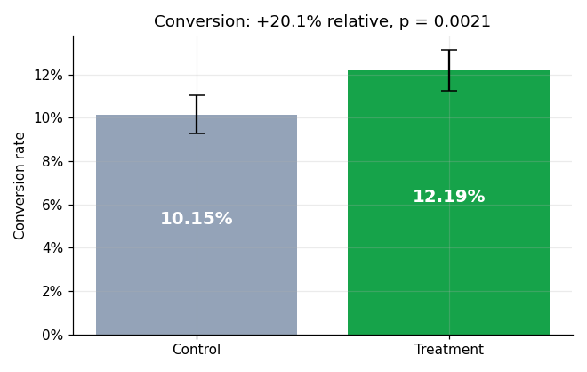
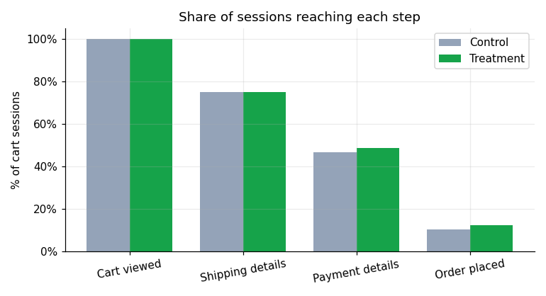
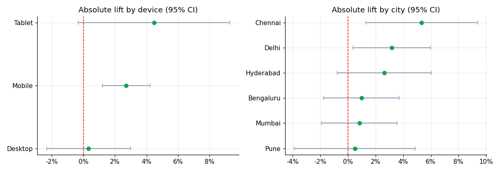
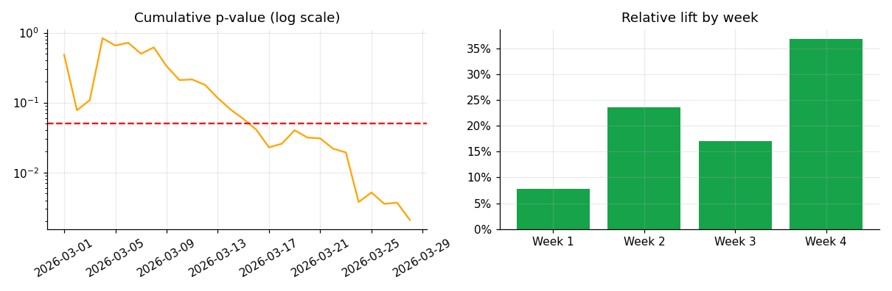

# GreenCart Checkout A/B Test: Statistical Analysis & Dashboard


**Python · SQL (SQLite) · SciPy · Streamlit · Plotly**

End-to-end analysis of a simulated checkout A/B test (9,000 sessions): experiment design, data validation, a
Sample Ratio Mismatch check, two-proportion z-test with confidence intervals, robustness checks, SQL funnel and
segment analysis, and an interactive dashboard that ends in a recommendation.

**Notebook:** [`notebooks/ab_test_analysis.ipynb`](notebooks/ab_test_analysis.ipynb) (full walkthrough with outputs) ·
**Dashboard:** `streamlit run app.py`

## Executive summary
**Ship the redesigned checkout**, rolling out to mobile first and monitoring revenue per session.

| | Control | Treatment |
|---|---|---|
| Sessions | 4,464 | 4,536 |
| Conversion | 10.15% | 12.19% |

- **+20.1% relative lift** (+2.04 pp), 95% CI [+0.74, +3.34] pp, z = 3.08, **p = 0.0021**
- **Data integrity:** all 7 SQL validation checks pass; SRM chi-square p = 0.45 (no mismatch)
- **Robust:** z-test, chi-square, Fisher exact and permutation test all give p ≈ 0.002; bootstrap CI matches; Bayesian P(treatment better) = 99.9%
- **Why it worked (funnel):** shipping step flat, payment step +3.8%, **payment → order +15.6% (p = 0.009)**
- **Where:** lift is concentrated on **mobile (+34.9%, p < 0.001)**; desktop is flat (+2.1%)
- **Consistency:** positive in every experiment week, no sign of a novelty effect
- **Guardrail:** revenue per session +13.6% but not significant (p = 0.06), so no revenue win is claimed

<p>
 
</p>
<p>
 
</p>

## Dashboard
Streamlit app in a green and cream theme with a sidebar, a home page of "Choose a question" cards, global **City** and **Device** filters
(they re-run every query), and eight pages:

- **Home:** pick a question
- **Experiment Brief:** hypotheses, metrics, design, decision rule
- **Executive Overview:** ship/no-ship verdict, KPI cards, city map, city ranking, device charts
- **Funnel & Trend:** checkout funnel, cumulative conversion and p-value, weekly lift
- **Segments:** forest plots, device × city heatmap, Bonferroni table
- **City Profile:** drill-through for one city versus all cities
- **Test Quality:** power curve, SRM, SQL data validation, robustness table
- **Impact:** orders and revenue calculator, revenue guardrail

An alpha slider drives the confidence intervals and the verdict.

## Access and roles
The demo is open (no login), so anyone with the link can view it. A **"View as"** selector in the sidebar shows each audience only the pages
they need: Executive (Overview, Impact), Product manager (Brief, Overview, Impact), Growth / marketing (Funnel & Trend, Segments, City Profile),
Engineering / QA (Test Quality, Funnel & Trend), Finance (Impact, Overview) and Analyst (everything). This is a convenience view, **not security**.

For private use, set an `APP_PASSWORD` environment variable (or in `.streamlit/secrets.toml`) and the app asks for it before showing anything.
For real user accounts and roles, Streamlit's OIDC login (`st.login`) with an identity provider is the production route.

## Data
Simulated, one row per session (`data/sessions.csv`):

| Column | Meaning |
|---|---|
| `session_id` | unique session |
| `variant` | `control` or `treatment` (50/50 random assignment) |
| `device`, `city` | segment attributes |
| `session_date` | 1 to 28 March 2026 |
| `converted` | 1 if an order was placed |
| `order_value` | order amount (0 if not converted) |
| `furthest_step` | 1 cart, 2 shipping, 3 payment, 4 order placed |

## Method
- **Design:** sample size from the two-proportion formula (planned 10% baseline, 20% relative MDE, alpha 0.05, 80% power → 3,841 per group); decision rule fixed before analysis.
- **Validation:** SQL checks for duplicates, nulls, valid values, date window and funnel consistency.
- **SRM:** chi-square goodness-of-fit against 50/50, flagged at p < 0.001.
- **Test:** two-sided two-proportion z-test (pooled), unpooled CI for the difference; verified against `chi2_contingency` (z² = χ²).
- **Robustness:** Fisher exact, exact permutation test, bootstrap CI, Bayesian Beta-Binomial model.
- **SQL:** CTE with `LAG()` for the funnel, `SUM() OVER` for running totals, `GROUP BY` for segments and weekly lift.
- **Segments:** per-segment z-tests with Bonferroni-adjusted p-values; treated as exploratory.
- **Guardrail:** revenue per session with a Welch t-test.

## Project structure
```
generate_data.py          simulate sessions -> data/sessions.csv
analysis.py               SQLite load, z-test, CI, SRM, power, funnel, validation, robustness
sql/schema.sql            table definition
sql/queries.sql           the SQL used (overall, device, city, revenue, funnel, running totals, weekly)
app.py                    Streamlit dashboard
notebooks/                executed analysis notebook
tests/                    pytest checks (stats, SQL consistency, validation, robustness)
docs/                     figures used in this README
.github/workflows/ci.yml  runs the tests on every push
```

## Run locally
```bash
pip install -r requirements.txt
python generate_data.py
python -m pytest
streamlit run app.py
```
To open the notebook: `pip install jupyter`, then `jupyter notebook notebooks/ab_test_analysis.ipynb`.

## Limitations
- **The data is simulated.** Baseline conversion varies by device and the treatment effect (about 20%) was built in. The funnel pattern and segment
  differences come from the simulation, not real customer behavior, so this project demonstrates the method, not a real-world finding.
- The random seed (89) was chosen so the realized sample lands close to a 20% lift; another seed gives a similar but different result.
- Randomization is by session, not user, so repeat visitors are not modelled.
- Segment tests are exploratory; after Bonferroni correction only mobile stays clearly significant.
- In a real test: randomize by user, run at least one or two full weeks, reduce variance with CUPED, add more guardrails.
